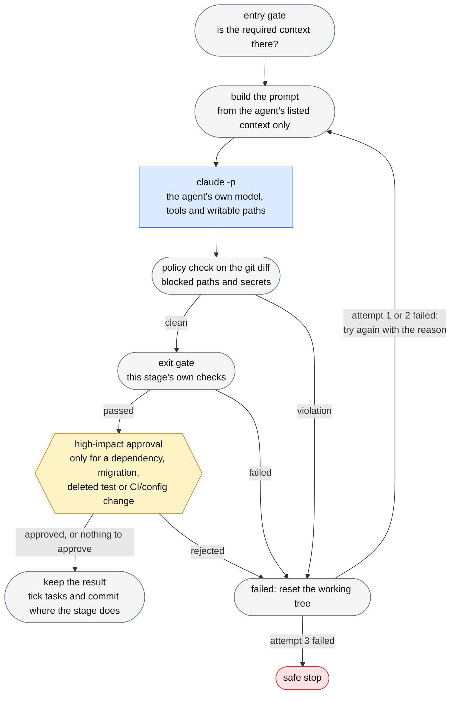
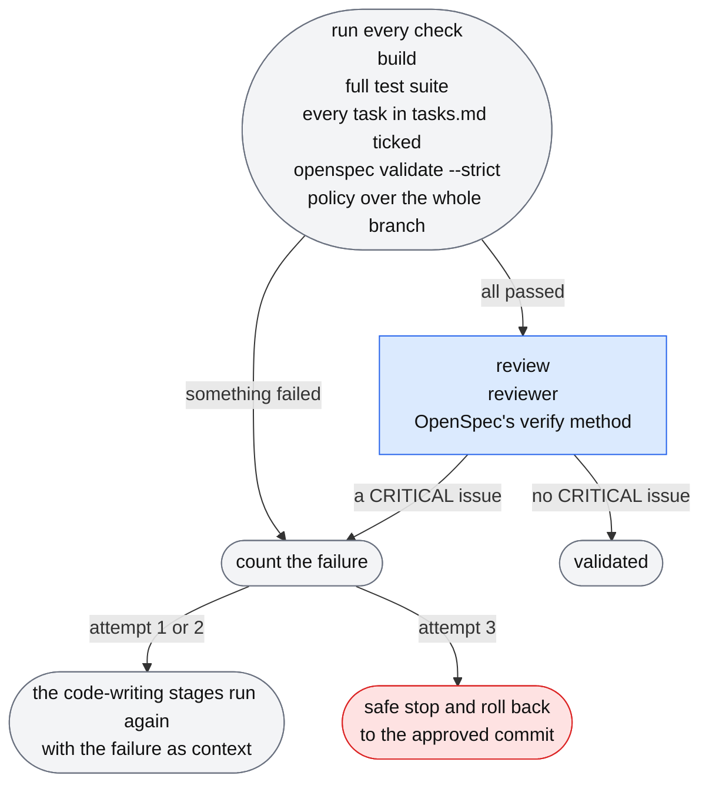
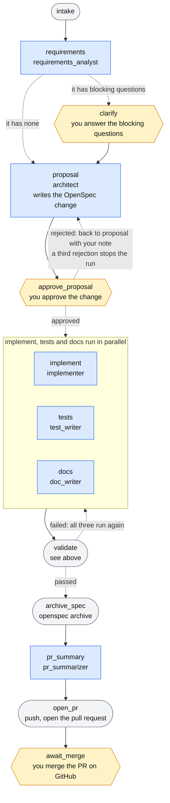
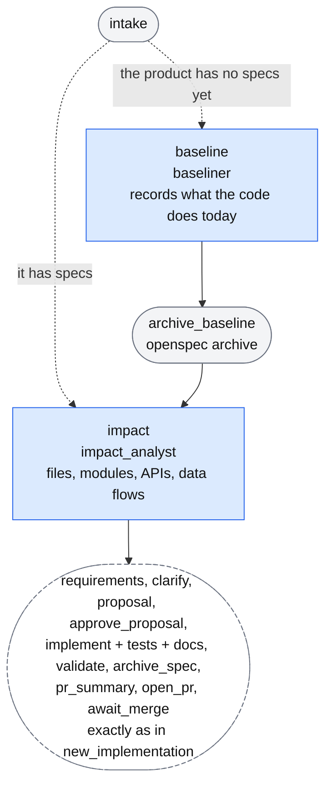
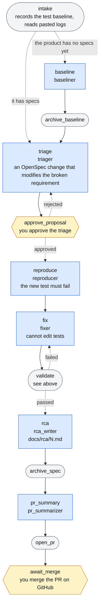
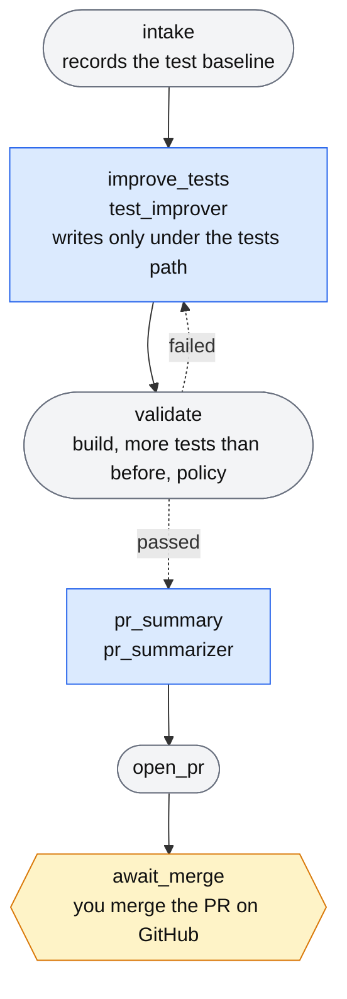
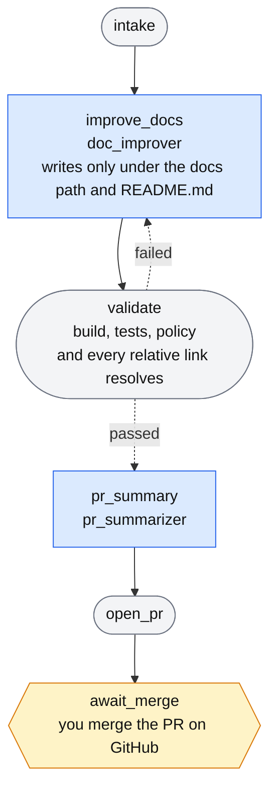
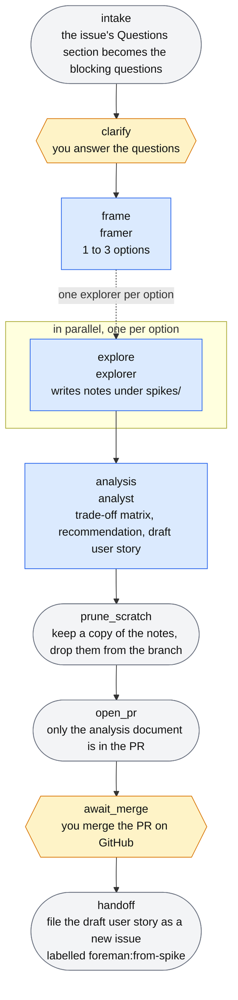
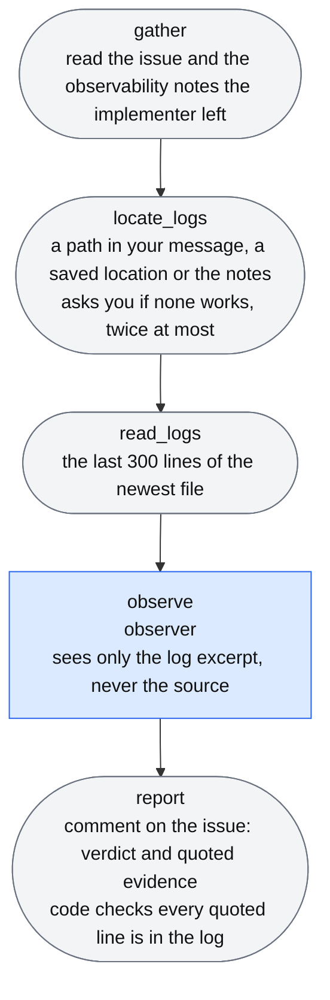

# Foreman

A governed agentic SDLC orchestrator. In Claude Code, inside your product's repository, you type `/foreman work on #1`; Foreman reads GitHub issue #1, a classifier agent decides what kind of work it is, and the matching workflow graph runs. LLM agents do the work inside defined boundaries; Foreman owns control: classification, ordering, gates, approvals, policy, retries, rollback, cost and audit. It stops and asks you wherever a decision is yours, and it ends with a pull request for you to review and merge.

**Foreman is product-agnostic and lives apart from your product.** You clone Foreman once. A small *skill* that you drop into your product repo (`.claude/skills/foreman/SKILL.md`) drives it, and the only thing Foreman learns about a product is one file inside that product's repo, `.foreman/target.yaml` (build and test commands, where code, tests and docs live). Foreman's own code and prompts name no product.

The full design is in [DESIGN.md](DESIGN.md). This README is the practical guide: how to use it, what every file does, and which setting changes which behaviour.

**Status:** the orchestration logic is covered by an offline test suite (see [Tests](#8-tests)). It has **not** yet been run against real Claude, GitHub and OpenSpec; expect to tune prompts and fix small integration details on the first real runs.

## Quick start

Open Claude Code in your product's repository, copy the prompt below (use the copy button at the top right of the box), and paste it. Claude installs the Foreman skill into the repo and does the setup, asking before it clones, installs or creates anything.

```text
Set up Foreman in this repository.

1. Install the skill. Download https://raw.githubusercontent.com/ekrishnas/foreman/main/skill/foreman/SKILL.md and save it as .claude/skills/foreman/SKILL.md in this repository, creating the folders (use curl, or Invoke-WebRequest on Windows). Then read the file.
2. Follow that file's "Setup only" instructions now: do its steps 1 to 6 (find or clone Foreman, set up OpenSpec, check my issue tracker, GitHub login and repo access, create .foreman/target.yaml, and commit the setup), obeying its rules. Ask me before you clone, install or create anything, and stop after step 6. Do not start a run.
3. When it is done, tell me what is ready and that I start work with: /foreman work on #<issue number>
```

When it finishes, start work with `/foreman work on #1` (see [Using it](#3-using-it)). You need `uv` and Claude Code (logged in); the prompt checks for everything else. The prompt downloads the skill from this repository, so read [`skill/foreman/SKILL.md`](skill/foreman/SKILL.md) first if you want to know exactly what Claude will be told to do. Setup is described step by step in [Setup](#2-setup), including doing it by hand.

---

## 1. The seven kinds of work

You never pick one. The classifier reads your sentence, the issue and the repo, and chooses.

| Type | Chosen when | Steps | Ends with |
|---|---|---|---|
| `new_implementation` | build something new, and the repo has no application code yet | requirements → proposal → **you approve** → implement ‖ tests ‖ docs → validate + review → archive spec → PR | PR |
| `existing_change` | add or change a feature in a repo that already has code | (first run on a product with no specs: baseline) → impact analysis → then as above | PR |
| `bugfix` | something that worked is broken | (first run on a product with no specs: baseline) → triage → **you approve** → reproduce (test must fail) → fix → validate + review → root-cause doc → PR | PR |
| `test_improvement` | add or strengthen tests, no code changes | improve tests → validate → PR | PR |
| `doc_improvement` | write or fix documentation | improve docs → validate → PR | PR |
| `spike` | the requirement is ambiguous | clarify → frame options → explore in parallel → analysis → PR | PR + a follow-up issue |
| `observe` | "it is deployed, check the logs" | find logs → read → observer verdict | a comment on the issue |

Code double-checks the classifier: `new_implementation` is refused if the repo already has application code, and `existing_change`, `bugfix` and `test_improvement` are refused if it has none.

Each graph is drawn out in [The workflow graphs](#the-workflow-graphs).

## 2. Setup

**Per machine, once:** install `uv` and Claude Code (logged in). Everything else is checked and set up by the skill the first time you use it.

**Per product repo, once:** paste the [Quick start](#quick-start) prompt, or do the first step by hand: copy the skill into the repo and commit it.

```bash
# from the product repo (macOS/Linux)
mkdir -p .claude/skills/foreman
curl -o .claude/skills/foreman/SKILL.md https://raw.githubusercontent.com/ekrishnas/foreman/main/skill/foreman/SKILL.md
```
```powershell
# from the product repo (Windows PowerShell)
New-Item -ItemType Directory -Force .claude\skills\foreman | Out-Null
Invoke-WebRequest https://raw.githubusercontent.com/ekrishnas/foreman/main/skill/foreman/SKILL.md -OutFile .claude\skills\foreman\SKILL.md
```
(Or copy `skill/foreman/SKILL.md` from a Foreman checkout.) The clone URL near the top of the skill (`FOREMAN_REPO_URL`) is the one place to change if Foreman lives somewhere else.

Then open Claude Code in the product repo and type `/foreman work on #1`. The first time, the skill:

1. **Finds Foreman**, or asks where it is, or asks your permission to clone it somewhere outside the repo, and runs `uv sync` there.
2. **Sets up OpenSpec**: checks the `openspec` CLI (installs `@fission-ai/openspec@1.15.0` with your permission) and, if the repo has no `openspec/` folder, runs `openspec init --tools claude` (no questions asked; it also adds OpenSpec's own Claude Code skills, see [OpenSpec and the agents](#openspec-and-the-agents)).
3. **Works out your issue tracker** from the repo's remote (or the issue URL you paste), checks the CLI is installed and logged in (`gh` today), and checks you have write access to the repo.
4. **Creates the product profile**, `.foreman/target.yaml`: it inspects the repo, proposes the build and test commands and paths, and you confirm. For an empty repo it asks which language and runtime version you are building with.
5. **Installs the toolchain** the product needs, with your permission: the version the repo itself targets if it has code (from `global.json`, `<TargetFramework>`, `.nvmrc`, `go.mod` and so on), otherwise the language and version you chose (it recommends the newest stable). It uses the system package manager (`winget`, `brew`, `uv` for Python) or Microsoft's official script for .NET, and checks Docker if your tests need it. On Windows a permission prompt may appear; accept it.
6. **Makes sure `.gitignore` covers build output and `logs/`, and commits the setup files** (with your permission), because a run refuses to start from a dirty working tree.

Prerequisites it will check for: `git`, `uv`, `claude`, `gh` (logged in), `openspec`, and your product's own toolchain (the gates run its build and test commands).

**Manual setup** is the same thing by hand: `git clone` Foreman, `uv sync`, `npm install -g @fission-ai/openspec@1.15.0`, `gh auth login`, `openspec init --tools claude` in the product repo, and copy [`examples/target.yaml`](examples/target.yaml) to `<product>/.foreman/target.yaml` and edit it. On Windows, if Foreman's `.venv` was created with Python 3.15, delete it and run `uv sync` again (the project pins 3.13).

**Issue trackers:** GitHub Issues and GitHub pull requests only, for now. If the skill sees Azure DevOps or Jira it says so and stops (see [Improvements for later](#9-improvements-for-later)).

## 3. Using it

### From Claude Code (the normal way)

1. File the work as an ordinary GitHub issue in the product repo. For a bug, include steps to reproduce and expected versus actual. For an ambiguous idea, put open questions under a `## Questions` heading. `examples/` has two samples. **Or skip this:** describe the work in the Claude Code message instead (you can `@`-attach a file, for example `/foreman work on the architecture diagram @architecture-hld.svg`). The skill drafts the issue from your words, with a `## Questions` section if the request is open-ended, shows it to you, and creates it after your OK. The classifier will usually treat an open-ended request as a `spike`: Foreman asks you its questions, explores options and writes an analysis before anything is built.
2. In Claude Code, opened in the product repo:

   ```
   /foreman work on #1
   /foreman fix #3
   /foreman #1 is deployed to qa, check the logs and tell me if it works
   ```

3. Claude starts the run and keeps you posted. Whenever Foreman needs a person it stops, and Claude shows you the question and asks you:
   - **proposal**: approve or reject the OpenSpec change (with a reason, and the architect tries again);
   - **high impact**: approve or reject a dependency, migration, deleted-test or CI/config change;
   - **question**: a clarifying question, or "where are the logs?" (an empty answer to a clarifying question means "assume the simplest thing").
4. When the PR is open, Claude gives you the link. Review it on GitHub and merge (or close) it; the run notices and finishes.
5. Claude reports the type, the PR, the cost, and for `observe` the verdict, the evidence and the log file it used.

### From a terminal

Run these from the Foreman folder (or prefix with `uv run --directory <foreman>`).

```bash
uv run foreman run 1 --repo ../my-app --request "work on #1"   # blocks until the run ends; prints "run: <id>" first
uv run foreman pending --run <id> --wait 60                     # in another terminal: what is waiting for me?
uv run foreman respond 7 --approve                              #   answer request 7
uv run foreman respond 7 --reject --note "no new dependencies"
uv run foreman respond 8 --answer "Postgres"
uv run foreman resume <id>                                      # continue a safe-stopped or crashed run
```

| Command | What it does |
|---|---|
| `foreman run ISSUE [--repo PATH] [--request TEXT] [--budget USD]` | classify the issue and run the matching graph. `--repo` is the product repo (default: the current folder). `--request` is your sentence (the classifier uses it). Exit codes: `0` completed, `2` safe-stopped, `1` error |
| `foreman pending [--run ID] [--wait SECONDS]` | list open questions. With `--wait`, block until there is one, the run finished, or time is up |
| `foreman respond ID --approve \| --reject [--note TEXT] \| --answer TEXT [--who NAME]` | answer one question |
| `foreman resume RUN_ID` | continue from the last checkpoint. If classification never finished, classify again |
| `foreman update` | bring this Foreman checkout up to date with `origin/main` (a fast-forward). It refuses, and changes nothing, if Foreman has local edits, commits that are not on `origin/main`, or is not on `main`. Prints the new commits and whether `uv sync` is needed |
| `foreman doctor [--repo PATH] [--install-skill]` | check a product against this Foreman: is its copy of the skill current, and does its `.foreman/target.yaml` have the newest settings? `--install-skill` copies the latest skill into the product |
| `foreman logs [RUN_ID] [--problems] [--cost]` | what Foreman did. Without a run id: every run with its type, status and cost. With one: its timeline. `--problems` keeps only failed attempts, retries, stops and rollbacks; `--cost` adds what each agent call cost |

All commands accept `--runs-dir` (default: `runs/` in the Foreman folder).

### Keeping Foreman up to date

In Claude Code, type `/foreman update`. It updates your Foreman checkout (and runs `uv sync` if the dependencies changed), tells you what is new, replaces the product's copy of the skill with the latest (with your permission), and offers any new profile settings, such as `paths.ci`, `paths.ignore` and `requires`. It never discards local edits or unpushed commits in the Foreman folder: it stops and says why. The first time, before the product's skill knows `update`, run `git pull` in the Foreman folder, then `uv run foreman doctor --repo <your product repo> --install-skill` to copy the latest skill in.

### When a run stops

A run ends `safe_stopped` with a reason when a stage fails three times, validation fails three times (the branch is rolled back to the approved commit), the budget is spent, a PR is closed unmerged, or no one answers for 24 hours. The reason is printed and posted on the issue. Fix the cause (for example raise `budget_usd` in `runs/<id>/run.json`, or merge the PR), then `foreman resume <id>`.

### Checking what happened

Foreman records everything it does, in four places:

| Where | What you see | How |
|---|---|---|
| the output of `foreman run` (in Claude Code, the background command's output) | live progress lines: `[classify] classified: ...`, `[implement] stage_passed`, `[reproduce] attempt_failed: ...`, `[open_pr] pr_opened: <url>`, `[run] safe_stop: ...` | read the output of the run |
| the audit trail | every event with its time, stage, attempt and reason, and what each agent call cost | `foreman logs` and `foreman logs <run id> [--problems] [--cost]` |
| the issue thread on GitHub | a human-readable trail: classification, the proposal, validation results, the PR, merge, the observe verdict | open the issue |
| `runs/foreman.db` in the Foreman folder | the same audit trail as raw tables `audit_events`, `cost_events`, `human_requests` | any SQLite tool, or Python's `sqlite3` module |

```
$ foreman logs
20261029-101500-ab12  2026-10-29T07:48:47  bugfix   safe_stopped   5 events  $0.36

$ foreman logs 20261029-101500-ab12 --problems
07:48:47  reproduce          attempt_failed     reason=No failing test, no fix
07:48:47  run                safe_stop          reason=budget exceeded
```

When a run misbehaves, start with `foreman logs <run id> --problems`: it shows which stage failed, why, and how many times. Agent output is not stored: a failed attempt keeps its reason, not the model's full reply. `runs/<run id>/run.json` holds the run's settings and chosen type.

## 4. How it works

```
/foreman work on #1            (the skill, in the product repo, sets everything up and starts:)
foreman run 1 --repo <product> --request "..."
  preflight (tools on PATH, gh logged in, .foreman/target.yaml present)
  classifier agent  --> Type: bugfix  (+ code check against the repo)
  git branch foreman/<run id> in the product repo          (not for observe)
  the graph for that type, node by node, checkpointed to SQLite
      agent node:  entry gate -> prompt from the agent's listed context only -> claude -p
                   -> policy check on the git diff -> exit gate -> commit      (retry up to 2x with the failure fed back)
      human node:  write a request to the store -> wait for `foreman respond`
      PR node:     push, open PR, wait for a human to merge it on GitHub
```

- **LLMs propose; code decides.** Every agent output passes a deterministic gate (builds, tests pass, the reproduction really fails, quoted log lines really exist, listed files really exist, links resolve).
- **Least privilege.** Each agent gets its own model, tools, writable paths and context, passed as CLI flags on every call. Agents get no GitHub access and no network tools.
- **Everything is recorded.** Audit events, cost per agent call and human requests go to SQLite; the issue thread gets a human-readable trail.
- **Product-agnostic.** All product knowledge is `.foreman/target.yaml` in the product repo, plus what agents read from the repo itself (file tree, OpenSpec specs).

### The workflow graphs

Each kind of work is a LangGraph graph built by `foreman/workflows/<type>.py`. The diagrams below were taken from the compiled graphs, so the boxes and arrows are the ones in the code; the words on the dashed arrows come from the routing functions. Node names are the names the code and `foreman logs` use.

- **Blue rectangle:** an agent stage. An LLM works inside its boundaries (its own model, tools and writable paths) and code checks the result. The second line is the agent's name in `config/agents.yaml`.
- **Grey rounded box:** plain code, no LLM.
- **Amber hexagon:** Foreman stops and waits for you.
- **Solid arrow:** always taken. **Dashed arrow:** a choice made by code.

**From a request to a graph**

```mermaid
flowchart LR
    ask(["/foreman work on issue N<br/>the skill, in the product repo"]):::code --> pre(["foreman run N<br/>preflight, load .foreman/target.yaml"]):::code
    pre --> classify["classify<br/>classifier"]:::agent
    classify --> check(["code check against the repo"]):::code
    check -. "refused: the reason goes back to the classifier" .-> classify
    check -- "accepted" --> branch(["git branch foreman/RUN_ID<br/>not for observe"]):::code
    branch --> run_graph(["run the graph for that type<br/>the seven graphs below"]):::code
    run_graph --> out(["a pull request for you to merge<br/>observe: a comment on the issue"]):::code

    classDef agent fill:#dbeafe,stroke:#2563eb,color:#111
    classDef code fill:#f3f4f6,stroke:#6b7280,color:#111
```



**Inside every agent stage** (`run_stage` in `foreman/core/runner.py`). The same loop runs for every blue rectangle below. A failed attempt resets the working tree, and the reason is fed into the next attempt's prompt.



Before every call Foreman also checks the run's cost against its budget and stops if it is spent.

**What `validate` does** (new_implementation, existing_change, bugfix; test_improvement and doc_improvement run only the build, the tests and the policy check, with no review)



Foreman ticks a task in `tasks.md` only when the agent that did it ends its reply with `DONE: <task id>`. Foreman does not run a task's own verification step. A task nobody reports stays unchecked, and the validation fails with `tasks not reported done: 1.1 (Implementation), ...`, followed by each task's text. The comment on the issue shows what every failed check said (the end of a build or test output, the list of tasks) and the results of all checks, and the final stop repeats them: `validation failed 3 times: <what failed> (last checks: build: pass; tests: 7 passed; ...)`.

**new_implementation:** a new feature in a repo that has no application code yet



**existing_change:** a feature in a repo that already has code. It is the new_implementation graph with two steps in front.



**bugfix:** something that worked is broken



**test_improvement:** add or strengthen tests, no code changes



**doc_improvement:** write or fix documentation



**spike:** the requirement is ambiguous, so explore before building



**observe:** "it is deployed, check the logs". No branch and no pull request.



To check a diagram against the code after changing a graph, print the compiled graph (this one is `bugfix`):

```bash
uv run python -c "from unittest.mock import MagicMock; from foreman.workflows import GRAPHS; print(GRAPHS['bugfix'](MagicMock()).compile().get_graph().draw_mermaid())"
```

### OpenSpec and the agents

Foreman keeps control of the sequence. Its agents know OpenSpec and use its helper commands, but only Foreman's own code archives a change. Checked against the real CLI (version 1.15.0):

- **What OpenSpec has.** CLI commands (`init`, `list`, `context`, `new change`, `status`, `instructions`, `show`, `validate`, `archive`, ...). And, installed into the repo by `openspec init --tools claude`, Claude Code *skills and slash commands* for an interactive session: `/opsx:explore`, `/opsx:propose`, `/opsx:apply`, `/opsx:archive`, `/opsx:sync`, `/opsx:update` (`new`, `continue`, `ff`, `verify`, `bulk-archive`, `onboard` are optional extras). There is **no** `openspec explore`, `propose`, `apply` or `review` CLI command.
- **What each Foreman agent does with it:**

| Agent | OpenSpec |
|---|---|
| architect, triager | run the helpers `context`, `list`, `status`, `instructions`, `show`, `validate` and `new change`, so the change follows the installed version's own templates and the rules in `openspec/config.yaml`. They write the files; Foreman adds its requirements on top (API contract, task groups) |
| baseliner | the same helpers. On the first run for a product with code but no specs it explores the code and writes a *baseline* change (ADDED requirements only), which Foreman archives straight away so later changes have specs to build on or modify |
| implementer, test writer, doc writer, fixer | none. They work from the approved design and tasks; Foreman ticks the tasks |
| reviewer | read-only helpers. It applies OpenSpec's `verify` method: completeness, correctness and coherence, with CRITICAL, WARNING and SUGGESTION issues. A CRITICAL issue fails validation; warnings and suggestions go into the PR |
| Foreman's code | `validate --strict` as a gate (after the proposal or triage, and again at validation) and `archive --yes` at the end. No agent can run `archive` or `apply`: they are not in any agent's permissions |

- **Why not OpenSpec's own skills as the engine.** `/opsx:propose` and `/opsx:apply` are written for a conversation (they ask the user questions and stop after planning), would replace the parallel implement ‖ tests ‖ docs split with one agent, and have not been verified under `claude -p`. The helpers give the same format guarantees with none of that.
- **Verified with the real CLI** by writing the fake agents' output into a scratch repo: the change layout validates, `archive` creates `openspec/specs/<capability>/spec.md` and moves the change to `openspec/changes/archive/<date>-<id>`. This found two rules now in the prompts and in the test stand-in: a `MODIFIED` requirement replaces the whole block and must keep every existing scenario, and `## Why` should be at least 50 characters (a warning).
- **First run on a product with no specs.** `openspec/specs/` starts empty and fills as changes are archived, so a bugfix would have nothing to modify. The baseline step fills it once; if it is skipped, the triage gate accepts `ADDED`.
- **Not verified:** that the helpers behave as the prompts describe when an agent runs them under `claude -p`, and the quality of the baselines and reviews real agents produce.

## 5. What each file does

### The skill (copied into each product repo)

| File | What it does |
|---|---|
| `skill/foreman/SKILL.md` | The `/foreman` skill. A prompt that tells Claude to: find or clone Foreman, set up OpenSpec, identify the tracker and check login and repo access, create the product profile, commit the setup, start `foreman run` in the background, relay questions with `pending`/`respond`, and report. It also holds the OpenSpec instructions. Change this to change how Claude behaves around a run |
| `examples/target.yaml` | A template for `.foreman/target.yaml` |
| `examples/*.md` | Two sample issues |

### Entry points

| File | What it does |
|---|---|
| `foreman/cli.py` | The four commands (`run`, `resume`, `pending`, `respond`), output format, exit codes |
| `foreman/engine.py` | Builds a `Run` (preflight, product repo and profile, adapters), runs the router, creates the branch, compiles and drives the chosen graph, handles safe-stop and resume. Holds the SQLite file name and the tool list for the preflight check |
| `foreman/__init__.py` | `ROOT`, the Foreman folder, which `config/`, `prompts/` and `runs/` are relative to |

### `foreman/core/`: the machinery every graph shares

| File | What it does |
|---|---|
| `runner.py` | `Run` (everything one run needs), `Stage` (one agent step as data) and `run_stage`, which does entry gate → prompt → worker → policy → exit gate → retries → cost and audit → commit. `SafeStop` is the one way to stop a run. Max retries and the live progress lines live here |
| `context.py` | Builds each prompt from the agent's prompt file, a "Boundaries" block, and only the context keys listed for that agent. `PROVIDERS` are keys it can compute itself (repo tree, target profile, existing specs, diff stat, cost table, approvals, fix diff, and for the reviewer the change's tasks and specs and the branch diff) |
| `policy.py` | Checks a git diff: blocks writes outside the agent's paths and secrets; marks dependency, protected-path, deleted-test and CI/config changes as needing approval. Also expands `{paths.src}`-style placeholders |
| `human.py` | `StoreHuman`: asks a person through the store and blocks until answered; `Decision` |
| `config.py` | Loads `agents.yaml` and a product profile; `RunConfig`; the profile location (`PROFILE`); the list of types the router may choose (`WORKFLOWS`); turns `build_cmd`, `test_cmd`, `openspec_read` and `openspec_author` into scoped `Bash(...)` permissions |
| `util.py` | `sh` (run a command with timeout and output capture), glob matching, markdown section parsing, test-count parsing |

### `foreman/workflows/`: one file per graph

| File | What it does |
|---|---|
| `__init__.py` | `GRAPHS`: type name → graph builder. The router's choice is looked up here |
| `route.py` | The classifier stage, its gate (valid type, rationale, consistent with the repo) and `classify()` |
| `nodes.py` | Pieces used by several graphs: `State`, intake, clarify, proposal approval, the build/test/policy checks and `finish_validation`, `archive_spec`, `open_pr`, `await_merge`, and the gates for "wrote files under the path" and "has an Observability section" |
| `new_implementation.py` | Requirements, proposal, implement ‖ tests ‖ docs, validate. Its stages and gates are reused by `existing_change` |
| `existing_change.py` | The impact-analysis stage and its gate (every listed file must exist), then the `new_implementation` graph with the baseline in front |
| `baseline.py` | The first-run baseline: when `openspec/specs/` is empty, the baseliner writes a baseline change, Foreman archives it, and the graph carries on. Used by `existing_change` and `bugfix` |
| `review.py` | The review step (OpenSpec's `verify` method): runs once the build, tests and policy pass, checks the report, and turns CRITICAL issues into a validation failure. Used by `new_implementation`, `existing_change` and `bugfix` |
| `bugfix.py` | Triage, reproduce (must fail), fix, validate, RCA |
| `test_improvement.py` | Improve tests; gate: suite passes, grew, lost nothing |
| `doc_improvement.py` | Improve docs; gate: wrote docs, every relative link resolves |
| `spike.py` | Clarify, frame, parallel explore, analysis, hand-off issue |
| `observe.py` | Find the log location, read the logs, observer verdict, report |

### `foreman/adapters/`: the only code that talks to the outside

| File | What it does |
|---|---|
| `github.py` | Everything GitHub, through `gh`: issues, comments, PRs, merge state, waiting for a merge, creating the repo with branch protection |
| `gitops.py` | `GitRepo`: branch, commit, diff, reset, file tree, snapshot |
| `updater.py` | `foreman update` (fast-forward the checkout, never discarding anything) and `foreman doctor` (the product's skill copy and profile against this Foreman) |
| `specs.py` | The one place that calls the `openspec` CLI (validate, archive) |
| `workers.py` | `ClaudeCodeWorker`: one `claude -p` subprocess per attempt with that agent's model and tools; parses its JSON for text, tokens and cost. Which environment variables `claude` may see, and which tools are always denied |

### Other packages

| File | What it does |
|---|---|
| `foreman/state/store.py` | The SQLite store: audit events, cost events, human requests |
| `foreman/reports/pr.py` | The PR body and the cost table, built by code |

### Configuration and content (no Python)

| File | What it does |
|---|---|
| `config/agents.yaml` | For each of the 20 agents: model tier, tools, writable paths, context keys. Plus the tier → model mapping |
| `prompts/<agent>.md` | One file per agent: its role, inputs, rules, and the exact output format its gate expects |
| `pyproject.toml`, `uv.lock`, `.python-version` | Dependencies and the Python version |

### In the product repo (created by the skill)

| File | What it does |
|---|---|
| `.claude/skills/foreman/SKILL.md` | the skill, copied from `skill/foreman/SKILL.md` |
| `.foreman/target.yaml` | the product profile: see [below](#target-profile) |
| `openspec/` | created by `openspec init`; `specs/` is what the system does today, `changes/` holds proposed changes, `config.yaml` can carry project constraints |
| `.claude/skills/openspec-*`, `.claude/commands/opsx/` | OpenSpec's own Claude Code skills and commands (`/opsx:explore`, `/opsx:propose`, `/opsx:apply`, `/opsx:archive`, ...), added by `openspec init` |

### Tests

| File | What it covers |
|---|---|
| `tests/doubles/` | The fakes: `worker.py` and `behaviors.py` (a scripted stand-in for each agent), `github.py`, `openspec.py`, `target.py` (a tiny Python project), `human.py`, `run.py` (wires a `Run` to them), `scenario.py` |
| `tests/scenarios/` | Scripted runs, including fault injection |
| `tests/inputs/` | Issue texts for the tests |
| `tests/test_*.py` | One file per area; `*_e2e.py` run a whole graph end to end |

## 6. Settings: what to change to change a behaviour

### Agents and prompts

| To change... | Edit |
|---|---|
| which model an agent uses | `config/agents.yaml`: the agent's `tier` (small, mid, strong), or the `models:` map at the top |
| which tools an agent may use | `config/agents.yaml`: `tools` (`build_cmd`/`test_cmd` expand to the commands in the product profile) |
| where an agent may write | `config/agents.yaml`: `writable` (globs; `{paths.src}`, `{paths.tests}`, `{paths.docs}`, the optional `{paths.ci}` and `{paths.ignore}`, `{change}`, `{run_id}`, `{option}`) |
| what an agent is shown | `config/agents.yaml`: `context` (a trailing `?` makes a key optional). New keys must be put in the context by a node, or be a provider in `core/context.py` |
| what an agent is told, or the format it must reply in | `prompts/<agent>.md`. **If you change an output format, change its gate too** (the gates are in `workflows/*.py`) |
| how implementers must report logging | `prompts/implementer.md`, `prompts/fixer.md` and `gate_observability` in `workflows/nodes.py` |
| which OpenSpec commands an agent may run | the agent's `tools` in `config/agents.yaml` (`openspec_read`, `openspec_author`) and `OPENSPEC_READ`, `OPENSPEC_AUTHOR` in `core/config.py`. `archive` and `apply` are deliberately in neither |
| how strict the review is, and what it checks | `prompts/reviewer.md` (severity rules); what counts as blocking is `finish_with_review` in `workflows/review.py` (today: any CRITICAL issue) |
| how much of an unfamiliar product the baseline describes | `prompts/baseliner.md` (today: at most five capabilities, the part the issue concerns) |
| how the classifier decides | `prompts/classifier.md`; the code checks are in `workflows/route.py` |

### Your product (`.foreman/target.yaml` in the product repo)

| To change... | Edit |
|---|---|
| build and test commands | `commands.build`, `commands.test` |
| where source, tests, docs live | `paths.src`, `paths.tests`, `paths.docs`; optionally `paths.ci` (`.github/**`) and `paths.ignore` (`.gitignore`) |
| what the tests need on this machine | `requires: [docker]`: a run refuses to start, with a fix, while Docker is not running |
| what needs human approval | `dependency_manifests` (e.g. `**/*.csproj`), `protected` (e.g. `**/Migrations/**`); built-in rules for deleted tests and CI/config files are in `core/policy.py` |
| the GitHub repo name used if Foreman has to create the repo | `name` |
| which repo a run works on | `--repo PATH` on `foreman run` (the skill passes the repo Claude is open in) |
| where the profile is looked for | `PROFILE` in `core/config.py` |

### Limits and timing

| To change... | Edit |
|---|---|
| the budget per run | `--budget` (default 10.0, `RunConfig.budget_usd` in `core/config.py`); for a safe-stopped run, `budget_usd` in `runs/<id>/run.json` before resuming |
| retries per stage, and validation loops | `max_retries` in `core/runner.py` (`Run`, default 2) |
| how long one `claude` call may take | `timeout` in `adapters/workers.py` (`ClaudeCodeWorker`, default 1800 s) |
| what environment `claude` sees; tools always denied | `ENV_KEEP`, `DENIED_TOOLS` in `adapters/workers.py` |
| how often Foreman checks for your merge, and for how long | `wait_for_merge(interval=30, timeout=86400)` in `adapters/github.py` |
| how long Foreman waits for an answer | `StoreHuman(poll_s=2, timeout_s=86400)` in `core/human.py` |
| how many rejections of a proposal before stopping | `MAX_REJECTIONS` in `workflows/nodes.py` |
| where the database lives | `--runs-dir`, and `DB_NAME` in `engine.py` |

### Rules and checks

| To change... | Edit |
|---|---|
| secret patterns | `SECRET_PATTERNS` in `core/policy.py` |
| which files count as CI/config | `CONFIG_PATTERNS` in `core/policy.py` |
| the types the router can choose | `WORKFLOWS` in `core/config.py`, `GRAPHS` in `workflows/__init__.py`, the type list in `prompts/classifier.md`, and `NEEDS_EXISTING_CODE` in `workflows/route.py` |
| what must be in a spike analysis, RCA, or impact analysis | the section lists at the top of `workflows/spike.py`, `bugfix.py`, `existing_change.py` |
| when a baseline is needed | `needs_baseline` in `workflows/baseline.py` (today: `openspec/specs/` has no spec) |
| how many log lines the observer sees, how often it asks for a location | `MAX_LINES`, `MAX_BYTES`, `MAX_ASKS` in `workflows/observe.py` |
| what the PR description contains | `reports/pr.py` |
| tools checked before a run | `TOOLS` in `engine.py` |
| what Claude does around a run: where it looks for Foreman, the clone URL, the OpenSpec setup, which trackers it recognises, when it asks you, what it reports | `skill/foreman/SKILL.md` (then copy it into the product repos again) |

### Add a new kind of work

1. Add the agent(s) to `config/agents.yaml` and write `prompts/<agent>.md`.
2. Write `foreman/workflows/<type>.py` with a `build(run)` function returning a LangGraph `StateGraph`; reuse the nodes in `workflows/nodes.py`. `test_improvement.py` is the shortest complete example.
3. Register it in `GRAPHS` (`workflows/__init__.py`) and `WORKFLOWS` (`core/config.py`), and describe when to use it in `prompts/classifier.md`.
4. Add a fake behaviour for each new agent in `tests/doubles/behaviors.py` and an end-to-end test. A test checks that `WORKFLOWS`, `GRAPHS` and the prompt files agree.

### Target profile

```yaml
# <product repo>/.foreman/target.yaml
name: my-app                        # GitHub repo name if Foreman has to create one; defaults to the folder name
spec_format: openspec
paths: { src: "src/**", tests: "tests/**", docs: "docs/**", ci: ".github/**", ignore: ".gitignore" }  # ci and ignore are optional
commands:
  build: dotnet build
  test: dotnet test
dependency_manifests: ["**/*.csproj"]
protected: ["**/Migrations/**"]
requires: [docker]                  # optional: only if the tests need Docker
```

Things to get right in a profile:

- **Keep the `/**` on every path.** `src/**` matches the files under `src`; `src/` matches nothing, and every write would be refused.
- **Agents may only write inside `src`, `tests` and `docs`,** plus `ci` and `ignore` if the profile lists them. A solution file, `Dockerfile` or `docker-compose.yml` at the repo root would be refused, so keep them inside `src`. `ci` (`.github/**`) lets the implementer write CI workflows and Dependabot config; `ignore` (`.gitignore`) lets the implementer and test writer add ignore entries, such as a snapshot library's `*.received.*`. Each such change pauses for your approval like any CI or config change, and without the line the agent cannot write that path at all. The setup still makes sure `.gitignore` covers build output and `logs/`.
- **The commands must work from the repo root, and for a product with no code yet they must name where the first projects will live**, for example `dotnet build src/MyApp.Api` and `dotnet test tests/MyApp.Tests` rather than a bare `dotnet build` (which needs one project or solution in the root folder). The architect sees the profile and plans projects where the commands expect them.
- **The toolchain must really be installed.** For .NET that means an SDK (`dotnet --list-sdks` must list one), not only a runtime; if the tests use Testcontainers or a compose database, Docker must be running: put `requires: [docker]` in the profile and every run checks it first and stops with a fix if it is off. The skill checks both during setup.

## 7. Where things end up

| What | Where |
|---|---|
| work product | a branch `foreman/<run id>` in the product repo, then the PR |
| progress | comments on the GitHub issue (classification, proposal, validation, PR, verdict) |
| audit, cost, questions, checkpoints | `runs/foreman.db` in the Foreman folder (SQLite; open it with any SQLite tool) |
| a run's saved settings and chosen type | `runs/<run id>/run.json` |
| sandboxed stages' working folder | `runs/<run id>/sandbox/` |

## 8. Tests

```bash
uv run pytest -q
```

They run offline with a scripted stand-in for each agent, a fake GitHub, a stand-in for the OpenSpec CLI, a small throwaway project as the product, and a scripted human. Faults are injected per stage. Running the whole suite at once is heavy (it starts many subprocesses); run it in parts if the machine is short of memory, for example one `tests/test_*_e2e.py` file at a time.

**What they confirm** is Foreman's own logic: that each kind of request is routed to the right graph and a contradictory answer is rejected, that every graph runs end to end and wires its nodes correctly, that gates reject bad output and retries recover, that policy blocks writes outside an agent's paths and secrets, that the budget stops a run, that rollback and resume work, that the human question/answer channel works across processes, that the product profile is found in the product repo, and that `observe` finds logs and refuses invented evidence.

**What they do not confirm** is anything that needs a real model or real services: whether the prompts make real agents produce acceptable output, whether `claude -p` returns the JSON shape the worker expects, whether `gh` behaves as the adapter assumes, whether the skill's steps work smoothly in a real Claude Code session, and the quality of the code that gets written. Only real runs tell you that. Expect the first ones to need prompt and gate tuning.

Some tests assume a POSIX shell (`sleep`, `cat`, stub scripts); on native Windows run the suite under WSL for a clean result.

## 9. Improvements for later

Left out of this version to keep it small enough to read in an afternoon:

- **Azure DevOps and Jira.** Today only GitHub Issues and GitHub pull requests work. The skill already recognises the other trackers and stops with a clear message. Supporting them means splitting the GitHub adapter into a *tracker* (read a story, comment) and a *code host* (push, open and track PRs), then adding an adapter for each, using `az boards` / `az repos` and a Jira CLI.
- **Drive OpenSpec's own skills** (`/opsx:propose`, `/opsx:apply`, `/opsx:verify`) from the agents, once they are shown to work under `claude -p`. Today the agents use only OpenSpec's CLI helpers.
- **Skip unchanged stages** after a failed validation (hash each stage's inputs). Today a validation failure re-runs implement, tests and docs.
- **Model fallback and replay**: escalate to the strongest model after retries fail; record every worker call so a run can be replayed without Claude.
- **`foreman metrics` and `foreman cost`**, and SQL views for stage success, retry rate, MTTR, latency, human wait. The data is already in SQLite.
- **Log services for `observe`** (Datadog and similar) instead of local files.
- **Deploy and smoke-test stage** with an SLO verdict and an automatic revert PR plus bugfix issue on failure.
- **Postgres** for a shared, multi-user installation.
- **True parallelism**: a git worktree per parallel stage instead of one lock.
- **A real secret scanner** instead of regexes.
- **Observe by PR number**, and chaining: a failing `observe` opening a bugfix issue.
