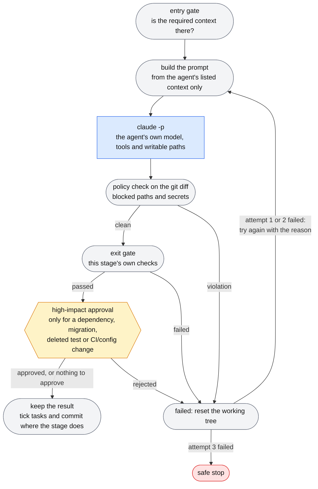
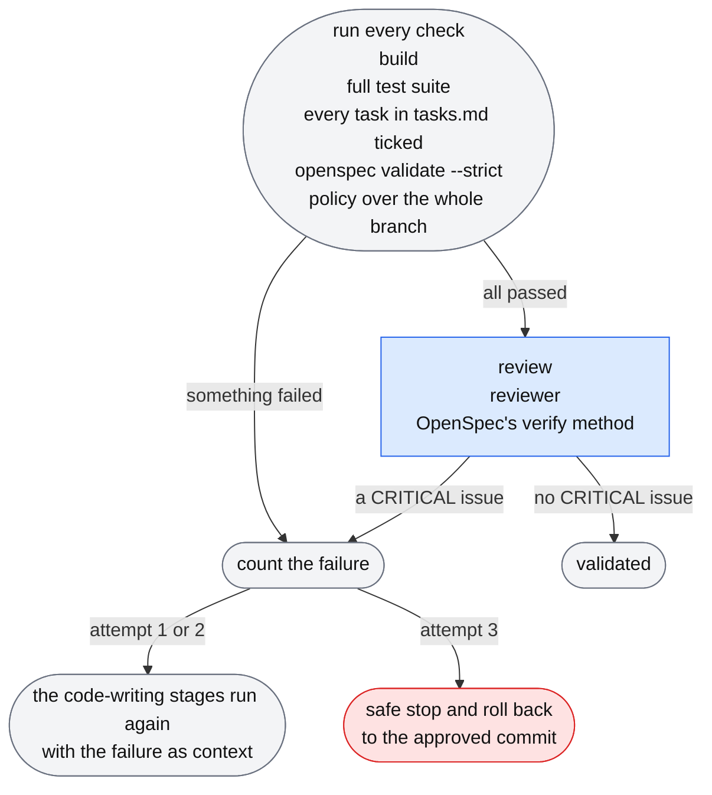
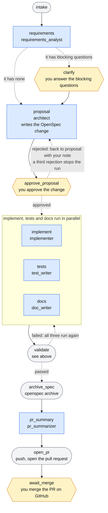
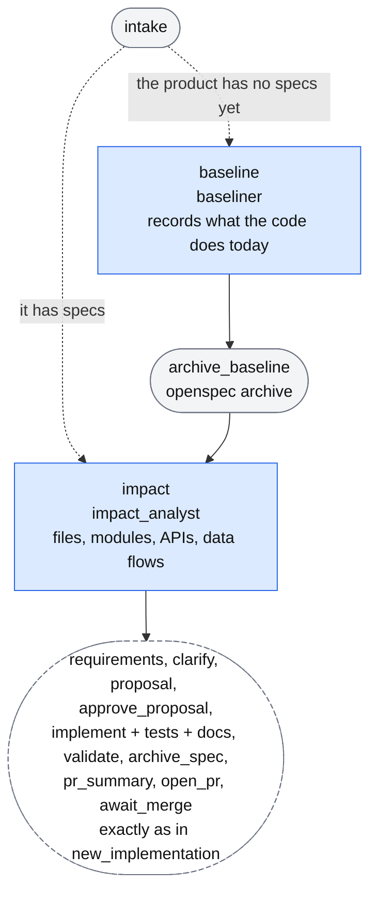
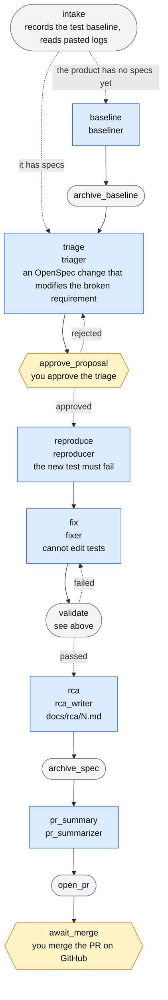
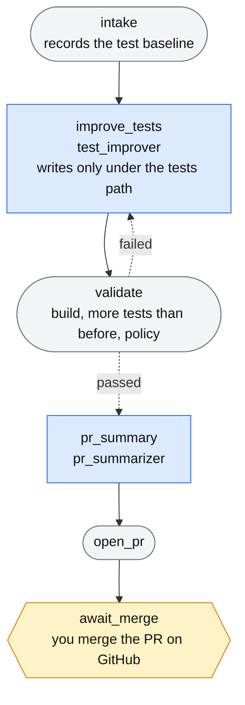
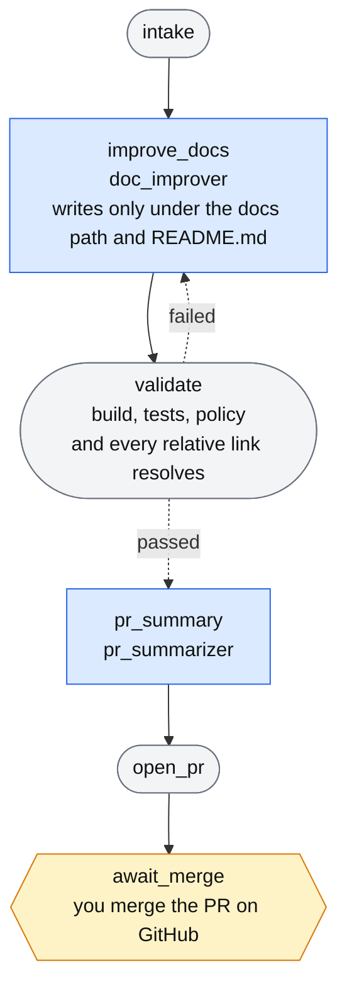
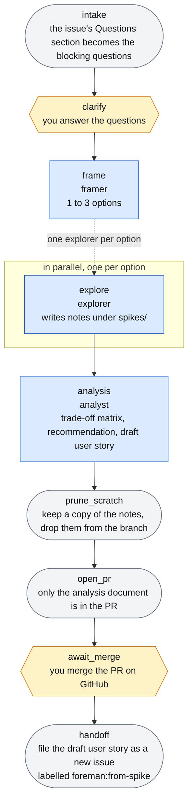
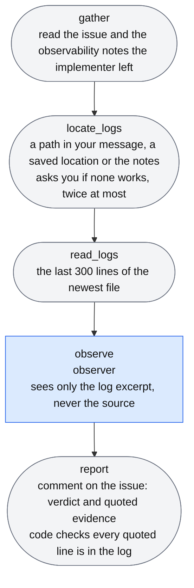

# Foreman workflow graphs

[Back to the README](README.md) · [Design](DESIGN.md)

Each kind of work is a LangGraph graph built by `foreman/workflows/<type>.py`. The diagrams below were taken from the compiled graphs, so the boxes and arrows are the ones in the code; the words on the dashed arrows come from the routing functions. Node names are the names the code and `foreman logs` use.

- **Blue rectangle:** an agent stage. An LLM works inside its boundaries (its own model, tools and writable paths) and code checks the result. The second line is the agent's name in `config/agents.yaml`.
- **Grey rounded box:** plain code, no LLM.
- **Amber hexagon:** Foreman stops and waits for you.
- **Solid arrow:** always taken. **Dashed arrow:** a choice made by code.

- [From a request to a graph](#from-a-request-to-a-graph)
- [Inside every agent stage](#inside-every-agent-stage)
- [What validate does](#what-validate-does)
- [new_implementation](#new_implementation)
- [existing_change](#existing_change)
- [bugfix](#bugfix)
- [test_improvement](#test_improvement)
- [doc_improvement](#doc_improvement)
- [spike](#spike)
- [observe](#observe)
- [Checking a diagram against the code](#checking-a-diagram-against-the-code)

## From a request to a graph

```mermaid
flowchart LR
    ask(["/foreman work on issue N<br/>the skill, in the product repo"]):::code --> pre(["foreman run N<br/>preflight, load .foreman/target.yaml"]):::code
    pre --> classify["classify<br/>classifier"]:::agent
    classify --> check(["code check against the repo"]):::code
    check -. "refused: the reason goes back to the classifier" .-> classify
    check -- "accepted" --> branch(["git branch foreman/RUN_ID<br/>not for observe"]):::code
    branch --> run_graph(["run the graph for that type<br/>the seven graphs below"]):::code
    run_graph --> out(["a pull request for you to merge<br/>observe: a comment on the issue"]):::code

    classDef agent fill:#dbeafe,stroke:#2563eb,color:#111
    classDef code fill:#f3f4f6,stroke:#6b7280,color:#111
```



## Inside every agent stage

This is `run_stage` in `foreman/core/runner.py`. The same loop runs for every blue rectangle in the diagrams below. A failed attempt resets the working tree, and the reason is fed into the next attempt's prompt.



Before every call Foreman also checks the run's cost against its budget and stops if it is spent.

## What `validate` does

This is the check in new_implementation, existing_change and bugfix. test_improvement and doc_improvement run only the build, the tests and the policy check, with no review.



Foreman ticks a task in `tasks.md` only when the agent that did it ends its reply with `DONE: <task id>`. Foreman does not run a task's own verification step. A task nobody reports stays unchecked, and the validation fails with `tasks not reported done: 1.1 (Implementation), ...`, followed by each task's text. The comment on the issue shows what every failed check said (the end of a build or test output, the list of tasks) and the results of all checks, and the final stop repeats them: `validation failed 3 times: <what failed> (last checks: build: pass; tests: 7 passed; ...)`.

## new_implementation

a new feature in a repo that has no application code yet



## existing_change

a feature in a repo that already has code. It is the new_implementation graph with two steps in front.



## bugfix

something that worked is broken



## test_improvement

add or strengthen tests, no code changes



## doc_improvement

write or fix documentation



## spike

the requirement is ambiguous, so explore before building



## observe

"it is deployed, check the logs". No branch and no pull request.



## Checking a diagram against the code

After changing a graph, print the compiled graph and compare it with the diagram (this one is `bugfix`):

```bash
uv run python -c "from unittest.mock import MagicMock; from foreman.workflows import GRAPHS; print(GRAPHS['bugfix'](MagicMock()).compile().get_graph().draw_mermaid())"
```
